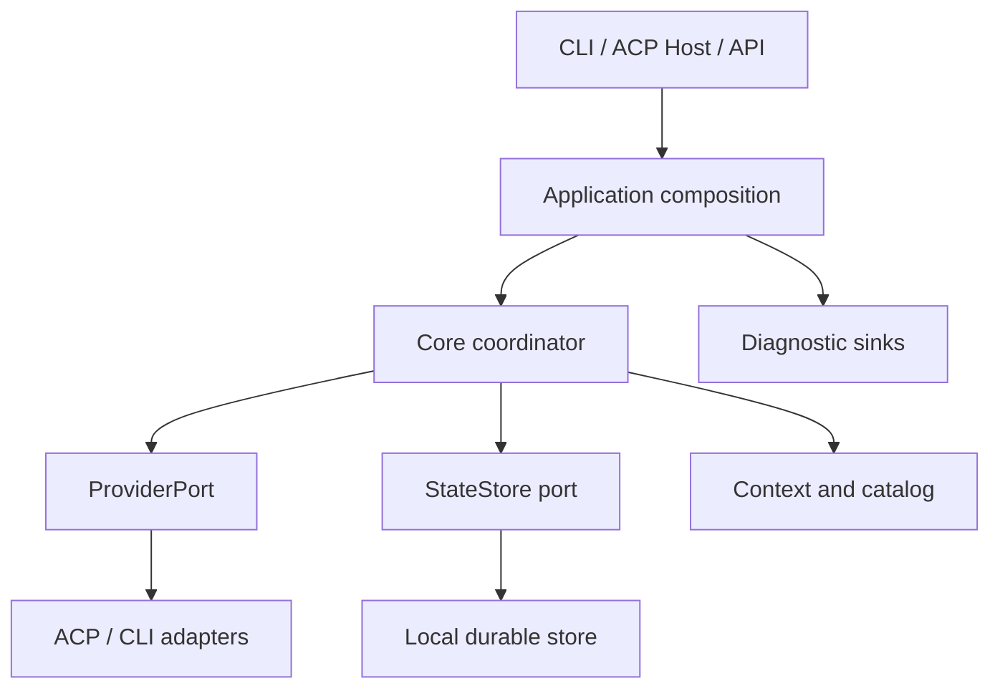

# Архитектура и владение

## Исполнение

Один процесс приложения владеет coordinator, provider sessions и state store. Controller — назначенный модельный профиль, вызываемый через тот же ProviderPort, что специалисты. «Одна модель» означает один профиль и отсутствие обязательных специалистов; последующие ходы этого же профиля допустимы. Вызов Controller может использовать нативные инструменты, если это разрешено его реальным профилем.

Стрелки обозначают вызовы; реализации портов внедряются composition root. Core не импортирует инфраструктурные реализации.

## Границы исходников новой реализации

| Слой | Предлагаемое размещение | Владеет | Не знает |
|---|---|---|---|
| Core | `src/core/` | operation/attempt contracts, решение о техническом dispatch, ресурсы, зависимости, cancel | Node fs/process, ACP wire, Git, SDK конкретной модели |
| Application | `src/application/` | use cases submit/resume/inspect/cancel, каталог, сбор контекста, конфигурация, связывание портов | содержательная стратегия решения задачи |
| Adapters | `src/adapters/` | provider protocols, local state, diagnostics, configured tool bridge | обязательные продуктовые стадии review/change |
| Hosts | `src/hosts/` | CLI и ACP client-facing транспорт, представление разрешений и результатов | правила достоверности семантических выводов |
| Composition | `src/main/` | создание экземпляров, ресурсы процесса, shutdown | собственный второй scheduler |

JavaScript (`.js`), ESM и Node.js 24 — выбранная база реализации. Контракты описываются JSDoc и проверяются TypeScript checker в режиме `allowJs`, `checkJs`, `strict`, `noEmit`; это инструмент разработки, а не язык исходников и не обязательная стадия запуска. Транспиляция в `dist/` не требуется. Core использует переносимые структуры/Promise/AbortSignal через объявленные порты; UUID, время, storage и процессное исполнение инъецируются. Поддержка Node 24 фиксируется `engines`; точные версии зависимостей и совместимость SDK проверяются при bootstrap. Исходный `package.json` пользователя сохранён с указанными версиями ACP dependencies; не подменять их без обоснования. Один продуктовый пакет; monorepo/microservices/DI framework не требуются.

## Владение состоянием

| Данные/ресурс | Владелец / запись | Завершение/восстановление |
|---|---|---|
| Operation snapshot | Coordinator через StateStore, один writer на state directory | atomic revision commit; восстановление по id |
| Attempts и reservation ресурсов | В той же operation snapshot | один reservation на attempt; late outcome изменяет учёт, не создаёт dispatch |
| Pending model proposals | Coordinator, привязка к decisionId | dedup id; replan только незапущенного; запущенное отменяется явно |
| Наблюдения и findings | Append-only logical records в snapshot/артефактах | модельная оценка добавляется отдельно; raw не переписывается |
| Provider process/session | Конкретный adapter | cancel, close, завершение owned process; без убийства чужих процессов |
| Клиентская ACP сессия | Host session registry | disconnect не равен завершению operation; политика disconnect задана явно |
| Diagnostic buffers | Diagnostic adapter | bounded flush/drop; сбой не изменяет смысл task state |

StateStore revision защищает запись собственных данных. Никакой связи с Git revision или содержимым source files нет. Для начального продукта достаточно одного writer-процесса на каталог собственного состояния; второй получает адресный `STATE_STORE_IN_USE`. Другие рабочие каталоги/операции и внешние редакторы не блокируются. Масштабируемая распределённая координация не входит в начальную реализацию.

Для CLI команды к живому владельцу (`cancel`, `inspect`, новый `run`/`resume`) идут через минимальный локальный control endpoint: Unix-domain socket на поддерживаемых POSIX платформах, соответствующий локальный adapter на иной заявленной платформе. Endpoint обслуживается владеющим Host-процессом, не вторым coordinator/store writer. При отсутствии живого владельца новый `run`/`resume` может приобрести store и стать владельцем; `cancel` сообщает, что живого исполнения нет, сохраняя неизвестные attempts для recovery. Обычный CLI процесс не запускает скрытый постоянный daemon. Команда к живому владельцу использует его доверенную конфигурацию и launch preferences. Явные overrides, отличающиеся от настроек живого владельца, дают адресный отказ. CLI-владелец публикует endpoint после получения writer lock, до инициализации провайдеров. Запрос к запускающемуся владельцу ждёт готовности в пределах 30 секунд от начала его startup. При shutdown новые run/resume отклоняются, а inspect, cancel и повторная доставка уже принятого запроса доступны до завершения принятых операций. Внешний ACP Host принимает через локальный endpoint inspect, trace, export и cancel. Для запуска и продолжения его операций нужна соответствующая ACP-сессия.

Контракт local control: version, requestId, action, operationId при наличии, payload; response содержит тот же requestId и outcome/error. Descriptor endpoint хранится только в собственном state directory, включает случайный session token и process identity; доступ ограничивается обычными пользовательскими правами каталога. Token не попадает в логи. Неподходящий token/version отклоняется. Это защита control channel от случайного/чужого обращения, не sandbox и не гарантия против злонамеренного процесса того же пользователя. Подключение/потеря клиента не повторяет запрос без requestId dedup. Владелец живёт, пока есть активная работа или обслуживаемая Host-сессия; shutdown удаляет только свой endpoint/descriptor и освобождает store.

## Минимальный цикл

1. Host принимает запрос/событие пользователя и сохраняет operation.
2. Context builder формирует модельный контекст и доступный каталог.
3. Controller предлагает действия либо итог/уточнение.
4. Coordinator проверяет форму, id, зависимости, доступный профиль, доверенную конфигурацию, cancel и ресурсы. Он не оценивает качество плана.
5. Для допустимого dispatch сохраняет attempt/reservation, вызывает adapter, принимает события и исход.
6. Доступные результаты передаются Controller согласно выбранной политике ожидания. Цикл продолжается до итогового ответа, реального ожидания пользователя/ресурса или отмены.

Проверка одной proposal не блокирует все actions: отказ и его причина возвращаются модели, независимые уже разрешённые actions продолжаются. Атомарные группы допускаются только если потребность доказана конкретным контрактом, не по умолчанию.

## Workspace и полномочия

Workspace descriptor содержит рабочую директорию и описательный label, если они предоставлены. Директория не нормализуется до Git root. Проверка существования cwd адаптером относится к запуску конкретного процесса; потерянный cwd не означает потерю всей истории. Модель получает ошибку и может выбрать другой разрешённый контекст.

Не наблюдать фоновые файловые изменения ради допуска задач. Данные о VCS или изменениях, полученные моделью, допустимы как observations. Смена содержимого директории не отзывает authority автоматически. Явный доступ к новому ресурсу за пределами действующей политики проходит существующий механизм permission; он не определяется fingerprint проекта.

Host гарантирует ограничения только там, где контролирует dispatch, зарегистрированный tool endpoint или permission response. Инструкции «не исправлять исходники» передаются модели и провайдеру; они не превращаются в доказанное файловое confinement. Нативный permissions profile задаёт пользователь. Не включать/ослаблять его по скрытой классификации задачи.

## Внешняя ACP сессия

ACP v1 работает через `role-orchestrator acp --config FILE` и резервирует stdout для протокола. Сессии сохраняются в state directory. `session/load` воспроизводит сохранённый диалог и принимает новый абсолютный cwd без поиска Git или сверки исходников. Поддерживаются текстовые блоки. Клиентские MCP серверы не принимаются. Файлы и terminal передаются через вложенный ACP только с явным флагом `--relay-client-tools` и соответствующими client capabilities.

Клиентская сессия сохраняет привязку операции для permission и client tools после возврата уточняющего вопроса. Каждый вызов проверяет соединение и активность попытки. Потеря транспорта прекращает доставку событий и запросов разрешения этому клиенту. Принятая операция может завершиться в рамках действующих лимитов. Явный `session/cancel` адресуется активной операции этой сессии. При следующем запуске load восстанавливает историю без dispatch.

Обычный prompt продолжает последнюю завершённую или ожидающую операцию. Клиент может задать в `_meta.roleOrchestrator` стабильный `requestId` для повторной доставки, `continueOperationId` для продолжения указанной операции, `newOperation: true` для отдельной задачи или `supersedeOperationId` для замены указанной активной операции своей сессии. Продолжение с другим cwd сохраняет ранее записанный контекст и историю.

## Поставка и инженерная инфраструктура

Граница установленного приложения определяется направлением импортов и разрешённым списком файлов npm/Nix, не физическим размещением исходных тестов. `src/` не импортирует `tests/`, `scripts/`, `.agents/` и документы coding-агента. JavaScript ESM исполняется напрямую, JSDoc/checkJs участвует только в разработке. Перенос инженерных каталогов в C12.0 не изменяет Controller, ProviderPort, authority, состояние или lifecycle пользовательской операции.
