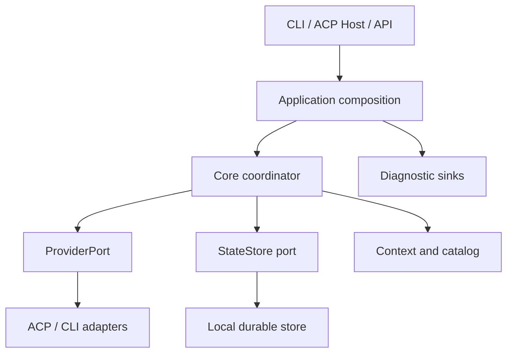

# Архитектура и владение

## Принципы владения и provider-first

- **Model-first:** модель владеет семантикой задачи, стратегией, выбором инструментов и исполнителей, делегированием и оценкой результата.
- **Provider-first:** клиент и провайдер остаются владельцами своих нативных возможностей; RO прежде всего соединяет их поддерживаемые контракты и добавляет только собственно оркестрационные обязанности.
- **Provider-agnostic:** различия нативных API и протоколов остаются за портами, не превращаются в специальные ветви Core и не требуют искусственного выравнивания возможностей исполнителей.

При проектировании новой возможности сначала определить, есть ли подходящий нативный контракт клиента или провайдера. Если есть, использовать минимальный технический мост: сохранить существенные данные, порядок, авторство и привязку к запросу/попытке в пределах применимого контракта. Пользовательские действия клиента (например, выбор файла, clipboard или контекст редактора) не требуют собственного аналога в RO; модель и провайдер определяют, как использовать полученные данные. Работа с реальным окружением, нативными инструментами и режимами не требует регистрации их семантики в Host.

Если прямой нативный контракт недостаточен для обязанностей RO, расширять существующие порты и жизненный цикл минимально, с конкретным обоснованием. Не создавать общий feature engine, дополнительный scheduler, обязательный discovery/reconciliation, эмуляцию нативных функций или универсальный слой надёжности провайдеров лишь ради унификации. Нативный контракт одного исполнителя может быть доступен независимо от поддержки у других.

Provider-first не является слепым passthrough: действующие authority, permission, resource, request identity, correlation, persistence, cancellation и unknown-effect/recovery contracts остаются обязательными. Собственные ошибки RO устраняются; внешние отказы и неподтверждённые возможности отражаются достоверно, без скрытой подмены настроек или обещаний чужих гарантий. Ограничение должно защищать конкретный технический инвариант или следовать фактическому контракту транспорта/исполнителя, а не компенсировать предполагаемые недостатки модели. Не требуется поддерживать все возможные расширения протокола заранее.

При инженерной проверке сопоставлять затронутые пользовательские сценарии напрямую через провайдера и через RO там, где это применимо и доступно. Цель — установить, не теряется ли функциональность именно из-за RO, а не требовать идентичного модельного поведения, времени выполнения или полного соответствия всем нативным функциям. Проверять сохранение собственного execution lifecycle и обычного пути без новых обязательных действий. Незапущенные native checks остаются UNVERIFIED. Это критерии разработки, не runtime stages или gates.

## Исполнение

Один экземпляр runtime владеет coordinator, provider sessions и выбранным state store; независимые экземпляры могут работать в разных Stores, в том числе в одном процессе API. Controller — назначенный модельный профиль, вызываемый через тот же ProviderPort, что специалисты. «Одна модель» означает один профиль и отсутствие обязательных специалистов; последующие ходы этого же профиля допустимы. Вызов Controller может использовать нативные инструменты, если это разрешено его реальным профилем.

Стрелки обозначают вызовы; реализации портов внедряются composition root. Core не импортирует инфраструктурные реализации.

## Границы исходников новой реализации

| Слой | Предлагаемое размещение | Владеет | Не знает |
|---|---|---|---|
| Core | `src/core/` | operation/attempt contracts, решение о техническом dispatch, ресурсы, зависимости, cancel | Node fs/process, ACP wire, Git, SDK конкретной модели |
| Application | `src/application/` | use cases submit/resume/inspect/cancel, каталог, сбор контекста, конфигурация, связывание портов | содержательная стратегия решения задачи |
| Adapters | `src/adapters/` | provider protocols, local state, diagnostics, configured tool bridge | обязательные продуктовые стадии review/change |
| Hosts | `src/hosts/` | CLI и ACP client-facing транспорт, представление разрешений и результатов | правила достоверности семантических выводов |
| Composition | `src/main/` | создание экземпляров, ресурсы процесса, shutdown | собственный второй scheduler |

JavaScript (`.js`), ESM и Node.js 24 — выбранная база реализации. Контракты описываются JSDoc и проверяются TypeScript checker в режиме `allowJs`, `checkJs`, `strict`, `noEmit`; это инструмент разработки, а не язык исходников и не обязательная стадия запуска. Транспиляция в `dist/` не требуется. Core использует переносимые структуры/Promise/AbortSignal через объявленные порты; UUID, время, storage и процессное исполнение инъецируются. Поддержка Node 24 фиксируется `engines`; точные версии зависимостей и совместимость SDK проверяются при bootstrap. Исходный `package.json` пользователя сохранён с указанными версиями ACP dependencies; не подменять их без обоснования. Один продуктовый пакет; monorepo/microservices/DI framework не требуются.

## Владение состоянием

| Данные/ресурс | Владелец / запись | Завершение/восстановление |
|---|---|---|
| Operation snapshot | Coordinator через StateStore, один writer на state directory | atomic revision commit; восстановление по id |
| Attempts и reservation ресурсов | В той же operation snapshot | один reservation на attempt; late outcome изменяет учёт, не создаёт dispatch |
| Pending model proposals | Coordinator, привязка к decisionId | dedup id; replan только незапущенного; запущенное отменяется явно |
| Наблюдения и findings | Append-only logical records в snapshot/артефактах | модельная оценка добавляется отдельно; raw не переписывается |
| Provider process/session | Конкретный adapter | cancel, close, завершение owned process; без убийства чужих процессов |
| Клиентская ACP сессия | Host session registry | disconnect не равен завершению operation; политика disconnect задана явно |
| Diagnostic buffers | Diagnostic adapter | bounded flush/drop; сбой не изменяет смысл task state |

StateStore revision защищает запись собственных данных. Никакой связи с Git revision или содержимым source files нет. Один writer на физический Store (включая алиасы пути) сохраняется; второй несовместимый runtime получает адресный `STATE_STORE_IN_USE`. Совместимый CLI peer обращается к действующему владельцу. Другие рабочие каталоги/операции и внешние редакторы не блокируются. Масштабируемая распределённая координация не входит в начальную реализацию.

Для CLI команды к живому владельцу (`cancel`, `inspect`, новый `run`/`resume`) идут через минимальный локальный control endpoint: Unix-domain socket на поддерживаемых POSIX платформах, соответствующий локальный adapter на иной заявленной платформе. Endpoint обслуживается владеющим Host-процессом, не вторым coordinator/store writer. При отсутствии живого владельца новый `run`/`resume` может приобрести store и стать владельцем; `cancel` сообщает, что живого исполнения нет, сохраняя неизвестные attempts для recovery. Обычный CLI процесс не запускает скрытый постоянный daemon. Run/resume к живому владельцу используют его доверенную конфигурацию и launch preferences. Совместимость учитывает исходные байты config и нормализованный логический configurationDirectory; исторический configurationRef в состоянии не меняется. Явные несовместимые launch overrides дают адресный отказ. Cancel/inspect/trace/export-diagnostics адресуются выбранному Store и Operation, не fingerprint конфигурации клиента; при явном --state-dir валидный config не нужен. При отсутствии endpoint или недоступности соединения до отправки запроса inspect/trace/export читают атомарно опубликованный validated snapshot без writer lock/runtime/maintenance, в том числе при активном writer; это не обещание newest revision. Только offline cancel проверяет существующий snapshot, затем наблюдает writer ownership; busy или неопределённое состояние не считается отсутствием живого writer. Отказ авторизации, protocol/command error или потерянный ответ не разрешают offline fallback. Наблюдение отсутствия writer относится к моменту проверки, не является reservation. Internal pending/answer/reconnect/subscribe и identity/token checks сохраняют исходные ограничения. Local-control v1 сохранён; смешанные старые/новые execution peers не гарантируют attach (несовпадение compatibility ref даёт отказ), а старый owner может отклонить административный запрос нового клиента без обязательного для старой версии configurationRef. Не обещать межверсионную совместимость и не делать автоматический fallback/replay; для новой семантики завершить старого владельца штатно и запустить текущую версию. CLI-владелец публикует endpoint после получения writer lock, до инициализации провайдеров. Запрос к запускающемуся владельцу ждёт готовности в пределах 30 секунд от начала его startup. При shutdown новые run/resume отклоняются, а inspect, cancel и повторная доставка уже принятого запроса доступны до завершения принятых операций. Внешний ACP Host принимает через локальный endpoint inspect, trace, export и cancel. Для запуска и продолжения его операций нужна соответствующая ACP-сессия.

Контракт local control: version, requestId, action, operationId при наличии, payload; response содержит тот же requestId и outcome/error. Descriptor endpoint хранится только в собственном state directory, включает случайный session token и process identity; доступ ограничивается обычными пользовательскими правами каталога. Token не попадает в логи. Неподходящий token/version отклоняется. Это защита control channel от случайного/чужого обращения, не sandbox и не гарантия против злонамеренного процесса того же пользователя. Подключение/потеря клиента не повторяет запрос без requestId dedup. Владелец живёт, пока есть активная работа или обслуживаемая Host-сессия; shutdown удаляет только свой endpoint/descriptor и освобождает store.

## Минимальный цикл

1. Host принимает запрос/событие пользователя и сохраняет operation.
2. Context builder формирует модельный контекст и доступный каталог.
3. Controller предлагает действия либо итог/уточнение.
4. Coordinator проверяет форму, id, зависимости, доступный профиль, доверенную конфигурацию, cancel и ресурсы. Он не оценивает качество плана.
5. Для допустимого dispatch сохраняет attempt/reservation, вызывает adapter, принимает события и исход.
6. Доступные результаты передаются Controller согласно выбранной политике ожидания. Цикл продолжается до итогового ответа, реального ожидания пользователя/ресурса или отмены.

Проверка одной proposal не блокирует все actions: отказ и его причина возвращаются модели, независимые уже разрешённые actions продолжаются. Атомарные группы допускаются только если потребность доказана конкретным контрактом, не по умолчанию.

## Workspace и полномочия

Workspace descriptor содержит рабочую директорию и описательный label, если они предоставлены. Директория не нормализуется до Git root. Проверка существования cwd адаптером относится к запуску конкретного процесса; потерянный cwd не означает потерю всей истории. Модель получает ошибку и может выбрать другой разрешённый контекст.

Не наблюдать фоновые файловые изменения ради допуска задач. Данные о VCS или изменениях, полученные моделью, допустимы как observations. Смена содержимого директории не отзывает authority автоматически. Явный доступ к новому ресурсу за пределами действующей политики проходит существующий механизм permission; он не определяется fingerprint проекта.

Host гарантирует ограничения только там, где контролирует dispatch, зарегистрированный tool endpoint или permission response. Инструкции «не исправлять исходники» передаются модели и провайдеру; они не превращаются в доказанное файловое confinement. Нативный permissions profile задаёт пользователь. Не включать/ослаблять его по скрытой классификации задачи.

## Внешняя ACP сессия

ACP v1 работает через `role-orchestrator acp --config FILE [--state-dir DIR]` и резервирует stdout для протокола. Сессии сохраняются в state directory. `session/load` воспроизводит сохранённый диалог и принимает новый абсолютный cwd без поиска Git или сверки исходников. Поддерживаются ordered text/image/audio/resource/link блоки; delivery зависит от negotiated native capabilities. Стандартные configOptions и доступные Agent Skills shortcuts предоставляются без отдельного native discovery session. Session selection не изменяет accepted generation. Клиентские MCP серверы не принимаются. Файлы и terminal передаются через вложенный ACP только с явным флагом `--relay-client-tools` и соответствующими client capabilities.

Клиентская сессия сохраняет привязку операции для permission и client tools после возврата уточняющего вопроса. Каждый вызов проверяет соединение и активность попытки. Потеря транспорта прекращает доставку событий и запросов разрешения этому клиенту. Принятая операция может завершиться в рамках действующих лимитов. Явный `session/cancel` адресуется активной операции этой сессии. При следующем запуске load восстанавливает историю без dispatch.

Обычный prompt продолжает последнюю завершённую или ожидающую операцию. Клиент может задать в `_meta.roleOrchestrator` стабильный `requestId` для повторной доставки, `continueOperationId` для продолжения указанной операции, `newOperation: true` для отдельной задачи или `supersedeOperationId` для замены указанной активной операции своей сессии. Продолжение с другим cwd сохраняет ранее записанный контекст и историю.

## Поставка и инженерная инфраструктура

Граница установленного приложения определяется направлением импортов и разрешённым списком файлов npm/Nix, не физическим размещением исходных тестов. `src/` не импортирует `tests/`, `scripts/`, `.agents/` и документы coding-агента. JavaScript ESM исполняется напрямую, JSDoc/checkJs участвует только в разработке. Перенос инженерных каталогов в C12.0 не изменяет Controller, ProviderPort, authority, состояние или lifecycle пользовательской операции.

## Live activity and interaction boundary (C13)

The existing Coordinator binds optional ProviderPort activity and native input interaction to the admitted Attempt. Activity is a bounded ephemeral view, not observation, finding or model context; execution notices are a separately bounded delivery view over existing diagnostic facts. Neither owns operation scheduling or model semantics. An interaction broker correlates a live native request to the configured trusted answer owner and existing invocation deadline; permission and Controller clarification remain independent. Local control v1 and ACP hosts consume these APIs using the same single owner and session/operation bindings. ACP capability declaration, negotiated route and trusted authority are separate. No workspace/VCS identity check, filesystem/process isolation, second state writer, durable stream, model reporting call, time-budget change or mandatory retrieval is introduced. Native support remains per transport; absent native events stay absent.

### C14 — presentation consumers

CLI и ACP читают C13 ActivityStream/Execution Events и authoritative operation snapshot. Renderer не участвует в orchestration, context, evidence, model selection, scheduling или outcome. Один terminal input owner на foreground work request; attached peer использует существующий local-control binding и pending delivery registry, не новый execution lifecycle. Prompt-scoped ACP subscription не меняет operation lifetime/route: background permission/form остаются возможны, если существующий route/client поддерживает их. Не объявлять отсутствующий native channel доступным.

### C13R/C14R — corrective presentation boundary
Normal consumer finish is a bounded transport drain after execution, not coordinator work. Committed finding records can flow to scoped subscribers directly from existing journal commit, without a separate state/index or diagnostic sink body. Native activity source metadata and interaction identity use the existing attempt/operation correlation; standard ACP notices are capability-gated presentation, not history or model context. C15 defaults instead to attributed standard agent_message_chunk; the user transcript is recovered from ordered session.requests and exact journal boundaries, not a second execution store. No dispatch/publication reorder; the accepted callback and committed-event projection feed scoped consumers. Native widgets and actionable routes remain independent. See [corrective roadmap](roadmap/C13R_C14R_INTERACTION_RELIABILITY.md).

## C18 — One Controller Decision lifecycle across transports

The provider adapter chooses delivery before prompt based on configured/negotiated capability. `ControllerIntent` is model-authored; technical binding fills only trusted correlation, observed revision, and profile attribution, then invokes the existing canonical Decision v1 decoder and unchanged application admission. MCP `submit_decision` is a local proposal mailbox with a native-completion barrier, **not** a new scheduler, persistent source of truth, Host plan or early dispatch mechanism. The ordinary provider-native tool surface continues for the entire native turn. The Operation journal, independent Workers, authority and resource bounds are unchanged.
